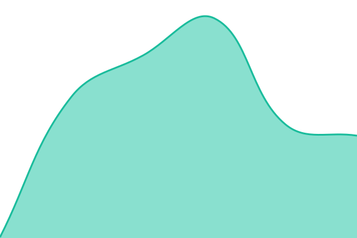
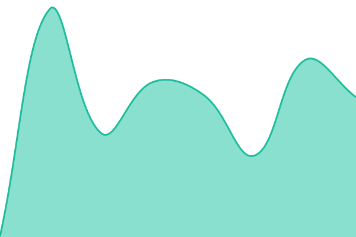
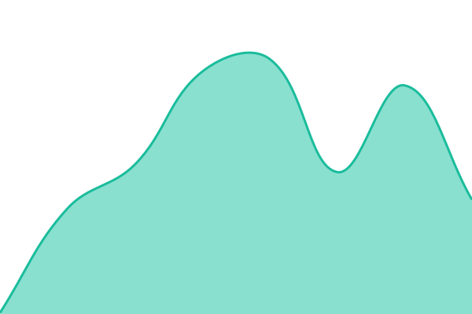
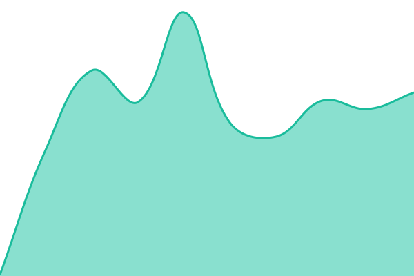
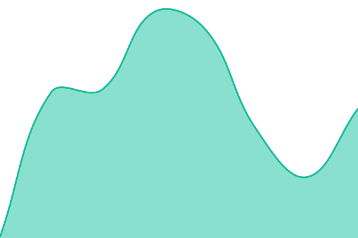
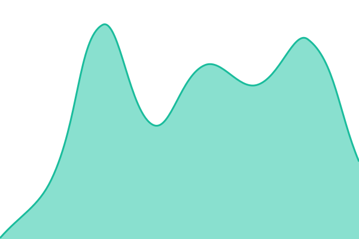

# [📈 Live Status](https://status.cloud.cocreiamo.com): <!--live status--> **🟩 All systems operational**

This repository contains the open-source uptime monitor and status page for [Cocreiamo](https://cocreiamo.com), powered by [Upptime](https://github.com/upptime/upptime).

With [Upptime](https://upptime.js.org), you can get your own unlimited and free uptime monitor and status page, powered entirely by a GitHub repository. We use [Issues](https://github.com/cocreiamo/status/issues) as incident reports, [Actions](https://github.com/cocreiamo/status/actions) as uptime monitors, and [Pages](https://status.cloud.cocreiamo.com) for the status page.

<!--start: status pages-->
<!-- This summary is generated by Upptime (https://github.com/upptime/upptime) -->
<!-- Do not edit this manually, your changes will be overwritten -->
<!-- prettier-ignore -->
| URL | Status | History | Response Time | Uptime |
| --- | ------ | ------- | ------------- | ------ |
|  [monitoring](https://monitoring.cocreiamo.com) | 🟩 Up | [monitoring.yml](https://github.com/cocreiamo/status/commits/HEAD/history/monitoring.yml) | 

 193ms
     
 | 

<a href="https://status.cloud.cocreiamo.com/history/monitoring">100.00%</a>
    

|  [deploy](https://deploy.cocreiamo.com) | 🟩 Up | [deploy.yml](https://github.com/cocreiamo/status/commits/HEAD/history/deploy.yml) | 

 181ms
     
 | 

<a href="https://status.cloud.cocreiamo.com/history/deploy">100.00%</a>
    

|  [portal](https://portal.cocreiamo.com) | 🟩 Up | [portal.yml](https://github.com/cocreiamo/status/commits/HEAD/history/portal.yml) | 

 164ms
     
 | 

<a href="https://status.cloud.cocreiamo.com/history/portal">100.00%</a>
    

|  [home](https://home.cocreiamo.com) | 🟩 Up | [home.yml](https://github.com/cocreiamo/status/commits/HEAD/history/home.yml) | 

 156ms
     
 | 

<a href="https://status.cloud.cocreiamo.com/history/home">100.00%</a>
    

|  [images](https://images.cocreiamo.com) | 🟩 Up | [images.yml](https://github.com/cocreiamo/status/commits/HEAD/history/images.yml) | 

 152ms
     
 | 

<a href="https://status.cloud.cocreiamo.com/history/images">100.00%</a>
    

|  [network](https://network.cocreiamo.com) | 🟩 Up | [network.yml](https://github.com/cocreiamo/status/commits/HEAD/history/network.yml) | 

 149ms
     
 | 

<a href="https://status.cloud.cocreiamo.com/history/network">100.00%</a>
    

|  [releases](https://releases.cocreiamo.com) | 🟩 Up | [releases.yml](https://github.com/cocreiamo/status/commits/HEAD/history/releases.yml) | 

 145ms
     
 | 

<a href="https://status.cloud.cocreiamo.com/history/releases">100.00%</a>
    

|  [runbooks](https://runbooks.cocreiamo.com) | 🟩 Up | [runbooks.yml](https://github.com/cocreiamo/status/commits/HEAD/history/runbooks.yml) | 

 157ms
     
 | 

<a href="https://status.cloud.cocreiamo.com/history/runbooks">100.00%</a>
    

|  [policies](https://policies.cocreiamo.com) | 🟩 Up | [policies.yml](https://github.com/cocreiamo/status/commits/HEAD/history/policies.yml) | 

 133ms
     
 | 

<a href="https://status.cloud.cocreiamo.com/history/policies">100.00%</a>
    

|  [storage](https://storage.cocreiamo.com) | 🟩 Up | [storage.yml](https://github.com/cocreiamo/status/commits/HEAD/history/storage.yml) | 

 151ms
     
 | 

<a href="https://status.cloud.cocreiamo.com/history/storage">100.00%</a>
    

|  [costs](https://costs.cocreiamo.com) | 🟩 Up | [costs.yml](https://github.com/cocreiamo/status/commits/HEAD/history/costs.yml) | 

 139ms
     
 | 

<a href="https://status.cloud.cocreiamo.com/history/costs">100.00%</a>
    

|  [errors](https://errors.cocreiamo.com) | 🟩 Up | [errors.yml](https://github.com/cocreiamo/status/commits/HEAD/history/errors.yml) | 

 142ms
     
 | 

<a href="https://status.cloud.cocreiamo.com/history/errors">100.00%</a>
    

|  [analytics](https://analytics.cocreiamo.com) | 🟩 Up | [analytics.yml](https://github.com/cocreiamo/status/commits/HEAD/history/analytics.yml) | 

 145ms
     
 | 

<a href="https://status.cloud.cocreiamo.com/history/analytics">100.00%</a>
    

<!--end: status pages-->

[**Visit our status website →**](https://status.cloud.cocreiamo.com)

## 📄 License

- Powered by: [Upptime](https://github.com/upptime/upptime)
- Code: [MIT](./LICENSE) © [Anand Chowdhary](https://anandchowdhary.com)
- Data in the `./history` directory: [Open Database License](https://opendatacommons.org/licenses/odbl/1-0/)
